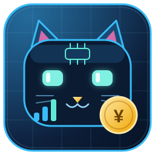
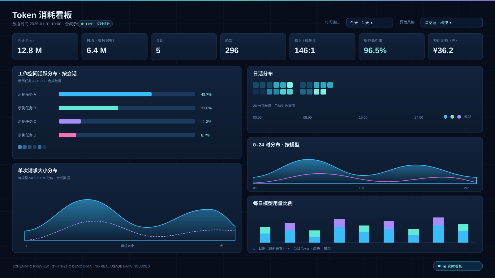

<p align="center">
  
</p>

<h1 align="center">Token Live Monitor</h1>

<p align="center">
  <strong>v1.0</strong> · WorkBuddy 的常驻 Token 消耗看板<br>
  开机即统计 · 随时可查看 · 单文件离线大屏 · 数据不出本机
</p>

<p align="center"><em>A zero-dependency, self-hosted live dashboard for WorkBuddy token usage.</em></p>

---

## 界面预览



> 上图是 **SVG 绘制的界面示意图，使用合成示例数据**，只用于展示布局与配色。仓库内不包含任何真实用量、会话标题、工作空间名称、日志内容或本机路径。

图标源文件：[`docs/icon.svg`](docs/icon.svg)（矢量，可直接用于文档与网页）。Windows 桌面图标以 `assets/token-live.ico.b64` 文本形式随仓库分发，运行 `python tools/restore_icon.py` 即可还原；位图 PNG 见发布压缩包。

---

## 这是什么

把 WorkBuddy 本机的**请求级真实 usage** 变成一张持续更新的单文件离线看板。与「问一次才生成一次静态快照」的工具不同，本项目随 WorkBuddy 启动后在后台增量采集，随时可看。

核心机制：

1. **随启动**：在用户级 `settings.json` 合并一条 `SessionStart` hook，新会话启动时幂等唤醒后台服务；登录自启动作为双保险。
2. **后台统计**：常驻进程按文件指纹增量扫描会话日志，只重读变化过的文件；把 KPI 与离线快照落盘，并在回环地址提供本地看板。
3. **随时查看**：本地网页、桌面按钮、会话内提示三条入口；数据变化时自动刷新，不打断下钻操作。

## 功能

- KPI：合计 Token / 日均 / 会话 / 轮次 / 输入输出比 / 缓存命中率 / 预估金额
- 日活热力图（20 分钟粒度）、0–24 时模型山脊图、每日模型用量堆叠柱、单次请求大小分布
- 工作空间 → 会话 → 单次请求三级下钻，会话标题自动识别
- 下拉菜单切换时间窗口（默认 1 天）与界面风格，选择自动记忆
- 5 套界面风格：极简浅色 / 经典深色 / 深空蓝·科技 / 赛博霓虹 / 玻璃拟态；图表配色随主题切换
- 数据仅来自本机日志，仅绑定 `127.0.0.1`，无外部 CDN、无上报、无第三方依赖

> 预估金额按脚本内 `PRICE` 表的牌价粗略计算，不同套餐价格不同，可自行修改。

---

## 安装

**环境**：Python 3.8+，仅标准库；Windows / macOS / Linux 均可。

### 1. 放到 WorkBuddy 用户级技能目录

```bash
git clone https://github.com/urey-bai/token-live-monitor.git ~/.workbuddy/skills/token-live-monitor
```

- Windows：`C:\Users\<用户名>\.workbuddy\skills\token-live-monitor\`
- macOS / Linux：`~/.workbuddy/skills/token-live-monitor/`

也可以直接解压 Release 压缩包到上述目录，目录内应能看到 `SKILL.md`。

### 2. 一键安装

```bash
python ~/.workbuddy/skills/token-live-monitor/scripts/install.py
```

安装会完成：写运行时配置、合并 `SessionStart` hook（自动备份配置文件）、注册登录自启动、创建桌面按钮、立即启动后台服务。重复执行是安全的，不会重复添加 hook。

| 参数 | 说明 |
| --- | --- |
| `--port 9000` | 本地端口，默认 `8765` |
| `--interval 20` | 采集间隔秒数，默认 `30` |
| `--projects <目录>` | 自定义会话日志目录 |
| `--no-autostart` | 只随 WorkBuddy 启动，不随系统登录启动 |
| `--no-hook` / `--no-shortcut` | 跳过 hook / 桌面按钮 |
| `--dry-run` | 只预览将做的改动 |

> 可选：Windows 专属桌面图标以文本形式保存，运行一次 `python tools/restore_icon.py` 即可还原 `assets/token-live.ico`；不运行也不影响使用，安装脚本会自动回退到系统默认图标。

### 3. 打开看板

浏览器访问 `http://127.0.0.1:8765/`，或双击桌面「Token Live Dashboard」按钮，或在 WorkBuddy 里说「看板」。

## 命令速查

| 命令 | 作用 |
| --- | --- |
| `python scripts/install.py` | 一键安装 / 刷新配置 |
| `python scripts/ctl.py status` | 运行状态 + 配置 + 关键数字 |
| `python scripts/ctl.py start / stop / restart` | 启动 / 停止 / 重启 |
| `python scripts/ctl.py open` | 唤醒服务并打开浏览器 |
| `python scripts/ctl.py once` | 只采集一次，生成离线快照 |
| `python scripts/uninstall.py` | 停用并移除启动项（`--purge` 额外删除状态文件） |
| `python scripts/dashboard.py --out 看板.html` | 独立生成静态快照 |

HTTP 接口：`/` 看板、`/api/stats` KPI、`/api/ping` 健康检查、`/refresh` 强制重采。

## 配置

运行时配置位于 `~/.workbuddy/token-live/config.json`：

| 项 | 默认 | 说明 |
| --- | --- | --- |
| `host` | `127.0.0.1` | 只绑回环地址，请勿改为 `0.0.0.0` |
| `port` | `8765` | 端口冲突时修改后 `ctl.py restart` |
| `interval` | `30` | 采集间隔（秒），最小 5 |
| `projects` | `~/.workbuddy/projects` | 会话日志目录 |

环境变量 `TOKEN_LIVE_PORT` / `TOKEN_LIVE_INTERVAL` / `TOKEN_LIVE_PROJECTS` / `TOKEN_LIVE_HOME` 可临时覆盖。更深入的机制、hook 规范与排障见 [`references/setup.md`](references/setup.md)。

## 目录结构

```
token-live-monitor/
├── README.md                    软件说明 · 图片展示 · 安装说明
├── SKILL.md                     Skill 定义
├── LICENSE                      MIT
├── VERSION                      v1.0
├── docs/                        图标与界面示意图
├── references/setup.md          深入配置与排障
├── scripts/                     后台服务、采集、控制、安装、卸载
├── assets/                      单文件看板模板 + 图标数据
└── tools/restore_icon.py        还原 Windows 桌面图标
```

## 隐私与安全

- 只读取会话日志里的 **usage 数值**与自动生成的会话标题，不解析对话正文，不展示对话内容。
- 本地服务只监听 `127.0.0.1`，生成的 HTML 无外部资源、无网络上报，可离线查看。
- 安装只追加一条 hook，不覆盖已有配置，修改前自动备份。
- 卸载逐项删除本工具创建的文件，不做递归清空。

## 版本

**v1.0** — 首个公开版本：常驻后台采集、单文件离线看板、下拉时间窗口、5 套界面风格、会话标题识别、桌面按钮与专属图标。

## 致谢

看板图表模板改编自开源项目 [fuyi-git/token-dashboard](https://github.com/fuyi-git/token-dashboard)，本项目在其基础上重构为常驻服务并独立实现了会话标题识别。模板已内置，使用本项目无需安装上游工具。

## 许可证

[MIT](LICENSE)
